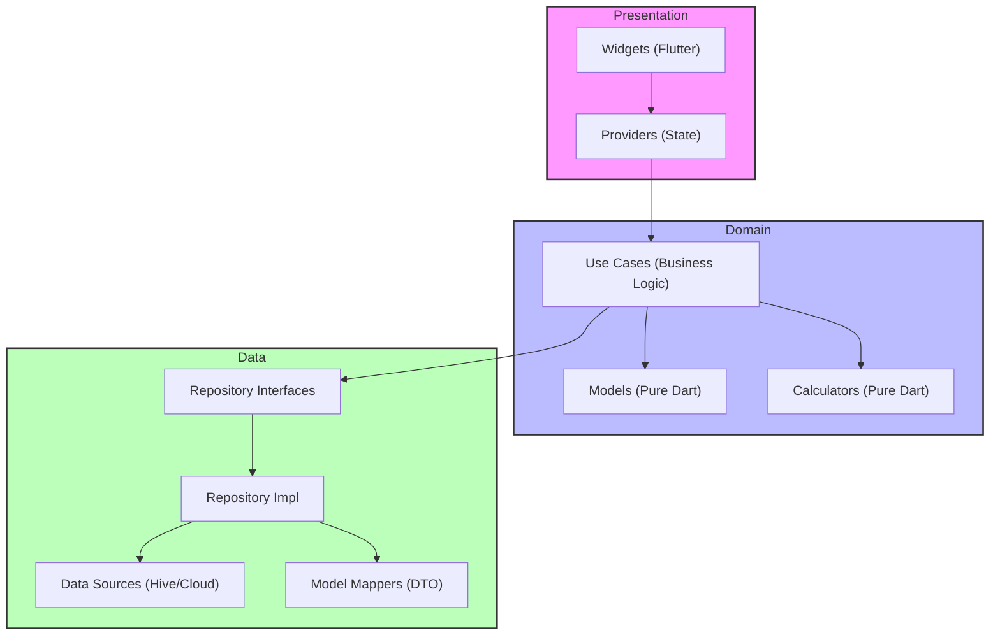
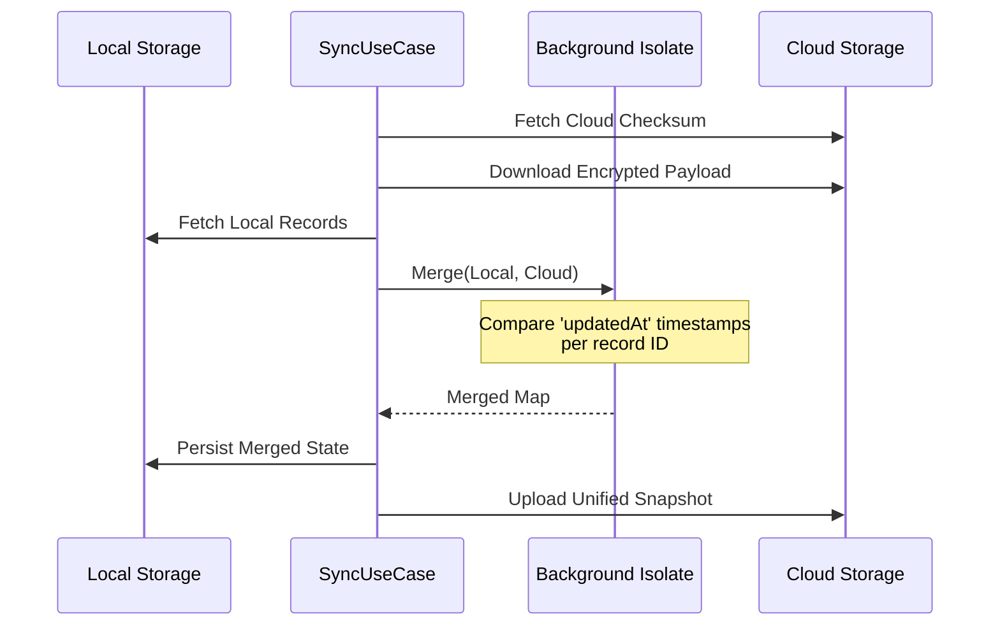

# Engineering & Development Guide

This guide provides a deep dive into the technical standards and architectural patterns of the Private Tracker App.

## 🏛 Clean Architecture Standards

We adhere to a strict 3-tier Clean Architecture to ensure business logic is isolated, testable, and reusable.

### 1. Domain Layer (`lib/domain/`)
- **Content**: Pure Dart models, Repository interfaces, and specialized Calculators.
- **Constraints**: **ZERO** dependencies on Flutter, Hive, or any external framework.
- **Key Files**: 
  - `models/`: Immutable business entities using `@immutable`.
  - `calculators/`: Logic for predictions and trends analysis.

### 2. Data Layer (`lib/data/`)
- **Content**: Persistence implementations, DTOs, and External Service clients.
- **Pattern**: The **Repository Pattern** is used to abstract storage details. DataSources handle low-level Hive ops.
- **DTO Mapping**: We use a explicit mapping layer (`model_mapper.dart`) to convert between Hive-compatible DTOs and pure Domain models.

### 3. Presentation Layer (`lib/presentation/`)
- **Content**: Flutter widgets, UI-only theme logic, and Providers.
- **State Management**: Selective rebuilds using `Selector` or `Consumer` to ensure 60FPS performance on heavy calendar views.

---

## ⚡ Thread-Safety & Isolate Architecture

To ensure a buttery-smooth 60FPS user experience, we offload all CPU-intensive operations to background **Isolates** using `Isolate.run`.

- **Trends Analysis**: `CycleProvider` uses an isolate to calculate complex trends and map them to calendar events.
- **Sync Parsing**: Large encrypted payloads are decrypted and parsed into DTOs in a background isolate.
- **LWW Merging**: The conflict resolution logic (Last-Write-Wins) for multi-device sync runs entirely off the main thread.

---

## 🔄 Data Synchronization (LWW Merge)

We use a record-level **Last-Write-Wins (LWW)** strategy for offline-first synchronization.

---

## 🛡 Security & Encryption Protocols

Private Tracker uses a Multi-Layered Encryption approach:

1.  **Encryption at Rest**: AES-256-SIC via `hive_flutter`.
2.  **Key Management**: 256-bit AES master key stored in KeyChain (iOS) or KeyStore (Android).
3.  **Authenticated Backup**: Password-based key derivation using PBKDF2 with HMAC-SHA256 integrity verification.

For a full security audit, see [SECURITY.md](file:///home/sungroa/git/private_tracker_app/SECURITY.md).

---

## 🧪 Testing Protocol

A feature is considered **Incomplete** if it lacks associated tests.

- **Domain Tests**: Test all calculators and model transformations in `test/domain/`.
- **Data Tests**: Verify storage serialization and encryption/backup flows in `test/data/`.

---

## 🛠 Project Lifecycle & DI

- **Service Locator**: We use `GetIt` (in `service_locator.dart`) for dependency injection of repositories and use cases.
- **App Initializer**: `lib/core/services/app_initializer.dart` coordinates the parallel startup of storage, providers, and initial sync.
