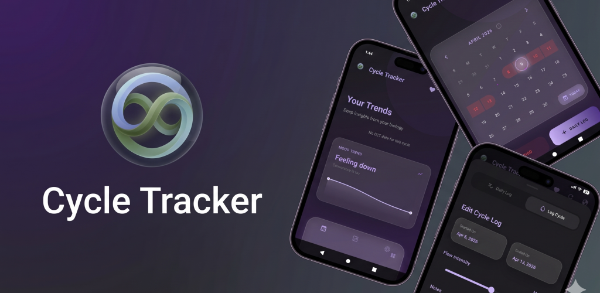

# 🌸 Private Tracker

A premium, privacy-focused health and cycle tracking application built with Flutter. Designed for zero-knowledge security and a luxury aesthetic.



## 🚀 Beta Access

Private Tracker is currently in Closed Beta. To try the app, please join our [Beta Testers Google Group](https://groups.google.com/g/private-tracker-app-closed-beta/about).

Once you are a member of the beta group, you can download the app from the [Google Play Store](https://play.google.com/store/apps/details?id=com.sry_developer.private_tracker_app). Note that the Play Store link will only work for users who have joined the beta group.

## ✨ Feature Highlights

- **🔒 Privacy First**: Zero-knowledge encryption. Your data never leaves your device unencrypted.
- **📈 Advanced Trends**: Isolate-powered "Cold Start to Hybrid ARIMA" statistical forecasting for period and fertility windows.
- **🔄 Secure Cloud Sync**: Multi-provider support (Google Drive / iCloud) with record-level Last-Write-Wins (LWW) conflict resolution.
- **🔔 Personalized Notifications**: Configurable reminder schedules for period predictions and fertility windows.
- **📄 Comprehensive Export**: Detailed, journal-style CSV data export for easy sharing with healthcare providers.
- **💎 Premium UI**: Glassmorphic design with smooth micro-animations and low-latency calendar interactions.
- **🧪 Industrial Grade**: 100% test coverage for domain logic and high-fidelity persistence audits.

## 🏗️ Technical Architecture

This project follows **Clean Architecture** principles to ensure long-term maintainability and technical excellence.

- **Layered Decoupling**: 
    - **Presentation**: Flutter + Provider (Selective Rebuilds).
    - **Domain**: Pure Dart models, Use Cases, and Isolate-driven Calculators.
    - **Data**: Repository pattern with Hive-backed encrypted storage and DTO mapping.
- **Thread Safety**: Heavy computations (Trends calculation, Sync parsing, LWW merge) are offloaded to background **Isolates** to maintain 60FPS UI performance.
- **Conflict Resolution**: Record-level merging using **Last-Write-Wins (LWW)** ensures consistent state across multiple devices without centralized servers.

## 🚀 Getting Started for Engineers

### 1. Prerequisites
- [Flutter SDK](https://docs.flutter.dev/get-started/install) (Stable channel)
- [Android Studio](https://developer.android.com/studio) or [Xcode](https://developer.apple.com/xcode/)

### 2. Setup
```bash
# Clone and install dependencies
git clone <repo-url>
cd private_tracker_app
flutter pub get

# Generate Hive adapters
flutter pub run build_runner build --delete-conflicting-outputs
```

### 3. Run
```bash
flutter run
```

## 🧪 Testing State
We maintain a strict commitment to technical excellence. No PR should be merged without passing all tests:
```bash
# Run all tests with expanded output
flutter test --reporter expanded
```

## 📦 Building for Production

Ensure all tests pass and Hive adapters are generated (`flutter pub run build_runner build`) before building.

### Android

#### 🔐 App Signing Setup (Release Mode)

For production builds, the app must be signed with a secure keystore.

1. **Generate Keystore**: Run the following command from the project root:
   ```bash
   keytool -genkey -v -keystore android/app/upload-keystore.jks \
           -keyalg RSA -keysize 2048 -validity 10000 \
           -alias upload
   ```

2. **Configure Credentials**: Edit `android/key.properties` and fill in the passwords you used in the step above:
   ```properties
   storePassword=YOUR_STORE_PASSWORD
   keyPassword=YOUR_KEY_PASSWORD
   keyAlias=upload
   storeFile=../app/upload-keystore.jks
   ```

3. **Security**: Both `upload-keystore.jks` and `key.properties` are excluded from git. **Ensure you back up these files securely.** Loss of these files will prevent you from updating the app on the Play Store.

#### Build Commands

```bash
# Build APK (Release)
flutter build apk --release

# Build App Bundle (Release)
flutter build appbundle --release
```

#### 📱 Local Testing with Play Store Installed

Debug builds use an `applicationIdSuffix` of `.dev`, which means they install as a **separate app** (`com.sry_developer.private_tracker_app.dev`) alongside the Play Store release version. This avoids the `INSTALL_FAILED_UPDATE_INCOMPATIBLE` signature mismatch error.

```bash
# Run debug build directly on device (coexists with Play Store version)
flutter run

# Or build and install manually
flutter build apk --debug
adb install build/app/outputs/flutter-apk/app-debug.apk

# View logs specifically for the local debug package
adb logcat --pid=$(adb shell pidof com.sry_developer.private_tracker_app.dev)
```

> **Note:** Debug and release builds have separate data sandboxes — your Play Store data is never affected by local testing.

### iOS
*Note: Requires macOS and Xcode.*
```bash
# Build IPA (Release)
flutter build ipa --release
```

### Web
```bash
# Build Web (Release)
flutter build web --release
```

## 📘 Further Reading
- [DEVELOPMENT.md](file:///home/sungroa/git/private_tracker_app/DEVELOPMENT.md): Detailed guide on architecture, security protocols, and coding standards.
